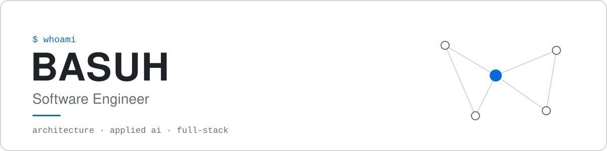

<picture>
  <source media="(prefers-color-scheme: dark)" srcset="assets/hero-dark.svg" />
  <source media="(prefers-color-scheme: light)" srcset="assets/hero-light.svg" />
  
</picture>

### About

I'm a software engineer who builds maintainable systems that actually ship.
I care about clear architecture, solid foundations and software people use.

- **Software architecture** — clean and hexagonal design, modular systems, decisions that age well.
- **Applied AI & agents** — LLM-powered products and agentic workflows, kept reliable with automated guardrails.
- **Full-stack** — from interfaces to APIs and data, end to end.

### Stack

| | |
|---|---|
| **Languages** | TypeScript · JavaScript · Python · C# |
| **Frontend** | Angular · React · Vite |
| **Backend** | Node.js · .NET |
| **Quality** | Vitest · Playwright · CI/CD |
| **AI** | LLMs · AI agents · MCP |

### Now

Learning, building and sharing around applied AI and software architecture.

### Principles

```text
Simple over clever.
Tested over assumed.
Shipped over perfect.
```
