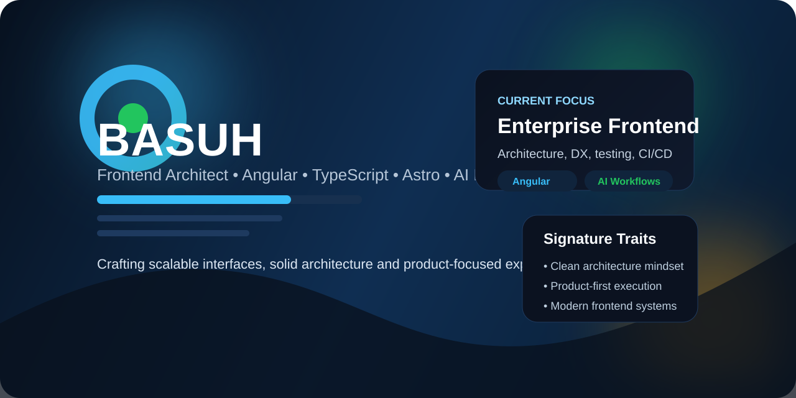

<p align="center">
  
</p>

<p align="center">
  
</p>

<p align="center">
  
  
  
</p>

<h1 align="center">BASUH</h1>
<p align="center">
  Desarrollo experiencias web modernas, arquitecturas frontend escalables y productos con foco real en calidad, mantenibilidad e impacto.
</p>

<p align="center">
  <a href="https://github.com/basuh94">
    
  </a>
  
  
</p>

## Snapshot

<table>
<tr>
<td width="52%" valign="top">

### Perfil

- Frontend / Full Stack Developer con foco en `Angular`, `TypeScript`, `Astro` y sistemas UI escalables.
- Interés fuerte en `Clean Architecture`, testing, DX y calidad de entrega.
- Construyendo productos y flujos con `IA aplicada`, no solo demos.
- Orientado a bases sólidas para equipos, proyectos enterprise y evolución a largo plazo.

### Lo que aporto

- Arquitectura frontend pensada para escalar
- Código mantenible y legible
- Estrategia de testing y guardrails de calidad
- Visión de producto y ejecución técnica

</td>
<td width="48%" valign="top">


</td>
</tr>
</table>

## Core Stack

<p>
  
  
  
  
  
  
  
  
</p>

## Featured Projects

<table>
<tr>
<td width="33%" valign="top">

### [`angular-archetype`](https://github.com/basuh94/angular-archetype)
Arquetipo Angular enterprise-ready con SSR, CI/CD, testing y guardrails para escalar proyectos con criterio técnico.


</td>
<td width="33%" valign="top">

### [`noticIAs-web`](https://github.com/basuh94/noticIAs-web)
Plataforma web autónoma para curar, puntuar y publicar noticias técnicas de IA con visibilidad operativa.


</td>
<td width="33%" valign="top">

### [`StarWars-Wiki`](https://github.com/basuh94/StarWars-Wiki)
Proyecto orientado a frontend que refuerza implementación UI, experiencia de usuario y desarrollo con TypeScript.


</td>
</tr>
</table>

## Activity and Momentum

<p align="center">
  
</p>

<p align="center">
  
</p>

## Signature Style

<p>
  
  
  
  
  
</p>

## Current Direction

```text
Building modern frontend systems.
Designing maintainable architecture.
Shipping web products with AI in the loop.
```
